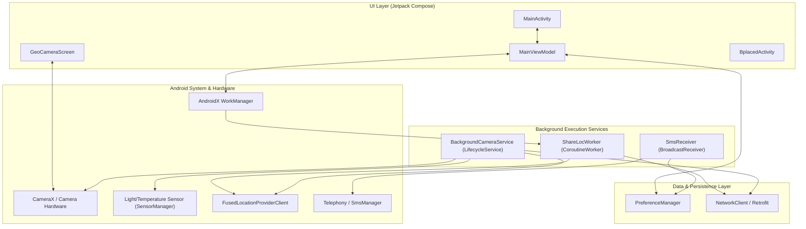
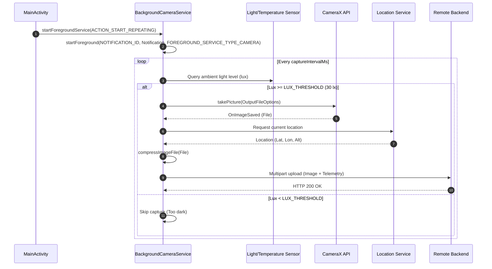

# ShareLoc GitHub Wiki Documentation

Welcome to the **ShareLoc** GitHub Wiki! This documentation repository provides technical guides, architecture deep-dives, API specifications, and background execution compliance details for developers working on or integrating with the ShareLoc Android application.

---

## 📚 Table of Contents

1. [Home](#-1-home)
2. [Architecture & Component Design](#-2-architecture--component-design)
3. [Background Camera Service](#-3-background-camera-service)
4. [WorkManager & Background Telemetry](#-4-workmanager--background-telemetry)
5. [SMS Direct Reply & Notifications](#-5-sms-direct-reply--notifications)
6. [Backend API Integration](#-6-backend-api-integration)
7. [Permissions & Android 14+ Compliance Guide](#-7-permissions--android-14-compliance-guide)

---

# 🏠 1. Home

## Project Overview
**ShareLoc** is a specialized Android application engineered for remote location tracking, ambient-aware background camera capture, automated telemetry logging, and interactive SMS notification management.

Key features include:
* **Jetpack Compose UI**: Declarative UI built with Material 3 design standards.
* **Ambient-Aware Camera Service**: Background camera capture conditioned on light-sensor (`Sensor.TYPE_LIGHT`) thresholds and geotagged with GPS coordinates.
* **Periodic WorkManager Task**: Background telemetry logging and image sync using `CoroutineWorker`.
* **SMS Direct Reply**: Notification-shade inline SMS reply using `RemoteInput` and `SmsManager`.
* **Backend Integration**: Retrofit 2 REST API client communicating with remote backend services (e.g., `bplaced.net`).

## High-Level Capabilities Matrix

| Component | Class | Tech / API | Description |
| :--- | :--- | :--- | :--- |
| **UI Layer** | [`MainActivity`](file:///C:/Users/altmi/AndroidStudioProjects/ShareLoc/shareloc/src/main/java/com/almica/shareloc/MainActivity.kt) | Jetpack Compose, Material 3 | Single-activity UI with tab navigation, controls, and status cards. |
| **State Management** | [`MainViewModel`](file:///C:/Users/altmi/AndroidStudioProjects/ShareLoc/shareloc/src/main/java/com/almica/shareloc/MainViewModel.kt) | Kotlin Coroutines, `StateFlow` | Unidirectional data flow for worker toggles, camera intervals, and preferences. |
| **Background Camera** | [`BackgroundCameraService`](file:///C:/Users/altmi/AndroidStudioProjects/ShareLoc/shareloc/src/main/java/com/almica/shareloc/backgroundcamera/BackgroundCameraService.kt) | `LifecycleService`, CameraX, FusedLocation | Foreground service for periodic photo capture and upload. |
| **Scheduled Telemetry** | [`ShareLocWorker`](file:///C:/Users/altmi/AndroidStudioProjects/ShareLoc/shareloc/src/main/java/com/almica/shareloc/ShareLocWorker.kt) | `CoroutineWorker`, WorkManager | Periodic background worker for telemetry sync and network checks. |
| **SMS Handling** | [`SmsReceiver`](file:///C:/Users/altmi/AndroidStudioProjects/ShareLoc/shareloc/src/main/java/com/almica/shareloc/SmsReceiver.kt) | `BroadcastReceiver`, `RemoteInput` | Receives incoming SMS and provides notification shade direct reply. |
| **Backend API** | [`BplacedApiService`](file:///C:/Users/altmi/AndroidStudioProjects/ShareLoc/shareloc/src/main/java/com/almica/shareloc/BplacedApiService.kt) | Retrofit 2, OkHttp 4 | Multipart image uploads and telemetry sync endpoints. |

---

# 🏗️ 2. Architecture & Component Design

ShareLoc follows modern **MVVM (Model-View-ViewModel)** architecture principles paired with **Unidirectional Data Flow (UDF)** and background service isolation.

## Architectural Diagram



## Data Flow Principles
1. **User Action / Events**: Emitted from Jetpack Compose composables to [`MainViewModel`](file:///C:/Users/altmi/AndroidStudioProjects/ShareLoc/shareloc/src/main/java/com/almica/shareloc/MainViewModel.kt).
2. **State Updates**: [`MainViewModel`](file:///C:/Users/altmi/AndroidStudioProjects/ShareLoc/shareloc/src/main/java/com/almica/shareloc/MainViewModel.kt) updates `StateFlow` streams (`isWorkerRunning`, `isBackgroundCameraRunning`, `workerLastRunTime`).
3. **Background Execution**: Services run independently in the background, updating shared preferences via [`PreferenceManager`](file:///C:/Users/altmi/AndroidStudioProjects/ShareLoc/shareloc/src/main/java/com/almica/shareloc/PreferenceManager.kt) and notifying the system shade via `NotificationManager`.

---

# 📷 3. Background Camera Service

The [`BackgroundCameraService`](file:///C:/Users/altmi/AndroidStudioProjects/ShareLoc/shareloc/src/main/java/com/almica/shareloc/backgroundcamera/BackgroundCameraService.kt) operates as an active Android Foreground Service (`LifecycleService`) designed for periodic, unattended capture and upload of ambient-conditioned photographs.

## Key Technical Specifications
* **Class**: [`BackgroundCameraService`](file:///C:/Users/altmi/AndroidStudioProjects/ShareLoc/shareloc/src/main/java/com/almica/shareloc/backgroundcamera/BackgroundCameraService.kt)
* **Foreground Service Type**: `camera|location`
* **Camera Pipeline**: CameraX [`ProcessCameraProvider`](file:///C:/Users/altmi/AndroidStudioProjects/ShareLoc/shareloc/src/main/java/com/almica/shareloc/backgroundcamera/BackgroundCameraService.kt) bound to `LifecycleService`.
* **Light Sensor Check**: Queries `Sensor.TYPE_LIGHT` via `SensorEventListener` before taking a picture. If ambient light is below `LUX_THRESHOLD` (default `30.0 lux`), photo capture is skipped to conserve power and avoid black photos.
* **Geotagging**: Acquires coordinates via `LocationManager` / `FusedLocationProviderClient` and attaches telemetry headers to the image payload.
* **Compression & Upload**: Compresses captured JPEGs via [`compressImageFile()`](file:///C:/Users/altmi/AndroidStudioProjects/ShareLoc/shareloc/src/main/java/com/almica/shareloc/backgroundcamera/BackgroundCameraService.kt) before sending multipart HTTP requests to the backend.

## Execution Sequence



---

# ⏱️ 4. WorkManager & Background Telemetry

Background periodic scheduling in ShareLoc is managed by **AndroidX WorkManager** via [`ShareLocWorker`](file:///C:/Users/altmi/AndroidStudioProjects/ShareLoc/shareloc/src/main/java/com/almica/shareloc/ShareLocWorker.kt).

## Key Characteristics
* **Class**: [`ShareLocWorker`](file:///C:/Users/altmi/AndroidStudioProjects/ShareLoc/shareloc/src/main/java/com/almica/shareloc/ShareLocWorker.kt) (subclass of `CoroutineWorker`)
* **Unique Work Tag**: `Constants.WORK_TAG`
* **Scheduling Mode**: `PeriodicWorkRequestBuilder` with configurable interval (minimum 15 minutes, standard WorkManager limitation).
* **Immediate Test Mode**: `OneTimeWorkRequestBuilder` enqueued via `testWorkerImmediately()` in [`MainViewModel`](file:///C:/Users/altmi/AndroidStudioProjects/ShareLoc/shareloc/src/main/java/com/almica/shareloc/MainViewModel.kt).
* **Foreground Info**: Implements `getForegroundInfo()` declaring `ServiceInfo.FOREGROUND_SERVICE_TYPE_CAMERA` on Android 11+ (API 30+).

## Reliability & Constraint Strategies
1. **Network Availability**: `isNetworkAvailable()` check verifies active cellular or Wi-Fi connectivity before attempting network transmission. Returns `Result.retry()` if disconnected.
2. **Battery & Notification Preferences**: Reads `isNotificationEnabled` from [`PreferenceManager`](file:///C:/Users/altmi/AndroidStudioProjects/ShareLoc/shareloc/src/main/java/com/almica/shareloc/PreferenceManager.kt) to send user status notifications when data connections cycle.

---

# 💬 5. SMS Direct Reply & Notifications

ShareLoc includes an integrated SMS listener and quick-reply notification system implemented in [`SmsReceiver`](file:///C:/Users/altmi/AndroidStudioProjects/ShareLoc/shareloc/src/main/java/com/almica/shareloc/SmsReceiver.kt).

## Features & Implementation
1. **High-Priority Channel**: Creates `sms_notifications_channel` with `NotificationManager.IMPORTANCE_HIGH`.
2. **Inline Direct Reply (`RemoteInput`)**:
   * Uses `RemoteInput.Builder(KEY_TEXT_REPLY)` attached to notification `NotificationCompat.Action`.
   * User enters text directly in the system notification shade.
3. **Intent Handling**:
   * Action `ACTION_REPLY_SMS` is received by [`SmsReceiver`](file:///C:/Users/altmi/AndroidStudioProjects/ShareLoc/shareloc/src/main/java/com/almica/shareloc/SmsReceiver.kt).
   * Extracts user input via `RemoteInput.getResultsFromIntent(intent)`.
   * Dispatches SMS using `SmsManager.getDefault().sendTextMessage(...)`.
4. **Android 10+ Background Compliance**:
   * Completely avoids launching background activities directly from `onReceive()`, adhering strictly to Android 10+ (API 29+) background activity start restrictions.

---

# 📡 6. Backend API Integration

Communication with the remote server (e.g. `bplaced.net`) is handled via Retrofit 2 in [`BplacedApiService`](file:///C:/Users/altmi/AndroidStudioProjects/ShareLoc/shareloc/src/main/java/com/almica/shareloc/BplacedApiService.kt).

## API Contracts & Endpoints

### 1. Telemetry & Data Logging
* **Endpoint**: `POST /upload.php` or custom backend entry point.
* **Content-Type**: `multipart/form-data`
* **Form Parameters**:
  * `username` (`RequestBody`): User account identifier.
  * `password` (`RequestBody`): Hashed or clear auth credentials.
  * `latitude` (`RequestBody`): Floating-point GPS latitude.
  * `longitude` (`RequestBody`): Floating-point GPS longitude.
  * `altitude` (`RequestBody`): GPS altitude meters.
  * `image` (`MultipartBody.Part`): Compressed JPEG file payload.

### 2. Location History Query
* **Endpoint**: `GET /get_locations.php`
* **Response Payload**: `List<BplacedLocationEntry>` containing timestamp, coordinates, and image URLs.

---

# 🛡️ 7. Permissions & Android 14+ Compliance Guide

To maintain compliance with **Google Play Store Policy** and **Android 14 (API 34) / Android 15 (API 35)** foreground service rules, ShareLoc defines specific permission bounds in [`AndroidManifest.xml`](file:///C:/Users/altmi/AndroidStudioProjects/ShareLoc/shareloc/src/main/AndroidManifest.xml).

## Required Manifest Permissions

```xml
<uses-permission android:name="android.permission.INTERNET" />
<uses-permission android:name="android.permission.ACCESS_NETWORK_STATE" />
<uses-permission android:name="android.permission.ACCESS_FINE_LOCATION" />
<uses-permission android:name="android.permission.ACCESS_COARSE_LOCATION" />
<uses-permission android:name="android.permission.ACCESS_BACKGROUND_LOCATION" />
<uses-permission android:name="android.permission.CAMERA" />
<uses-permission android:name="android.permission.SEND_SMS" tools:ignore="SmsAndCallLogPolicy" />
<uses-permission android:name="android.permission.RECEIVE_SMS" tools:ignore="SmsAndCallLogPolicy" />
<uses-permission android:name="android.permission.POST_NOTIFICATIONS" />

<!-- Foreground Service Specific Permissions (API 34+) -->
<uses-permission android:name="android.permission.FOREGROUND_SERVICE" />
<uses-permission android:name="android.permission.FOREGROUND_SERVICE_CAMERA" />
<uses-permission android:name="android.permission.FOREGROUND_SERVICE_LOCATION" />
```

## Foreground Service Declarations in Manifest

```xml
<service
    android:name="com.almica.shareloc.backgroundcamera.BackgroundCameraService"
    android:exported="false"
    android:foregroundServiceType="camera|location" />

<service
    android:name="androidx.work.impl.foreground.SystemForegroundService"
    android:exported="false"
    android:foregroundServiceType="camera|location"
    tools:node="merge" />
```

## Best Practices Checklist for Maintainers
* [x] **Runtime Permission Flow**: Always check and request `CAMERA`, `ACCESS_FINE_LOCATION`, and `POST_NOTIFICATIONS` permissions before initializing service components.
* [x] **Foreground Service Type Matching**: Ensure that the bitwise mask passed to `startForeground(id, notification, type)` inside Kotlin service code matches the `android:foregroundServiceType` attribute declared in [`AndroidManifest.xml`](file:///C:/Users/altmi/AndroidStudioProjects/ShareLoc/shareloc/src/main/AndroidManifest.xml).
* [x] **SMS Policy Exemptions**: Maintain `tools:ignore="SmsAndCallLogPolicy"` on SMS permissions unless publishing to production Play Store tracks without explicit declaration.
